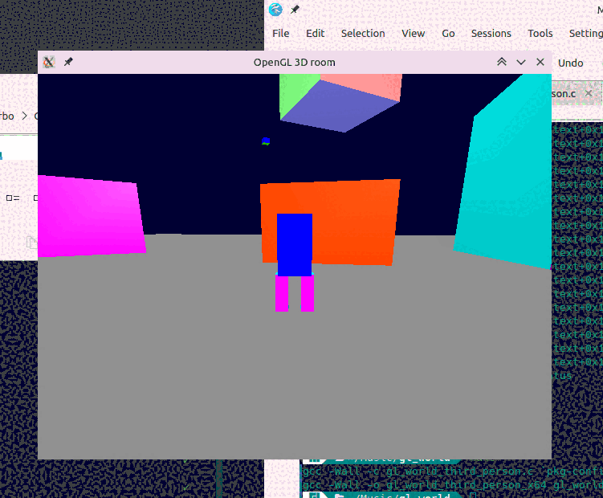

# OpenGL3Droom
A classic OpenGL open world third person camera demo written in SDL. Proper mouse view constraints like high end games. Cross platform, works on Linux/Windows.

Move mouse to rotate the world view.
Scroll mouse to zoom in and zoom out the view.
WASD keys to move around.
Directional arrow keys to rotate the view.
M/N keys to move world light.
f key to toggle fullscreen.
Excape key to shut the program.

See the program below:

*For usages and applications restrictions please refer to LICENSE*

Todo:
Mouse sensitivity is not quite right.

